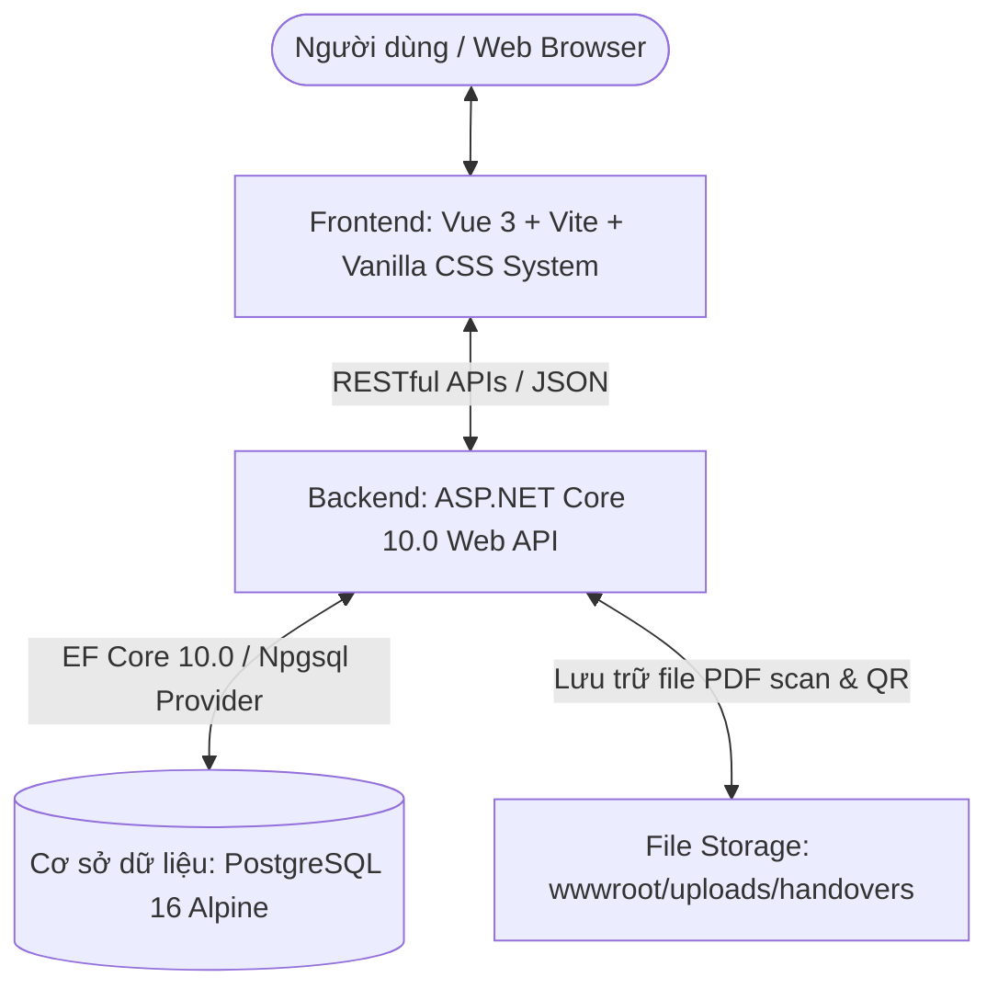
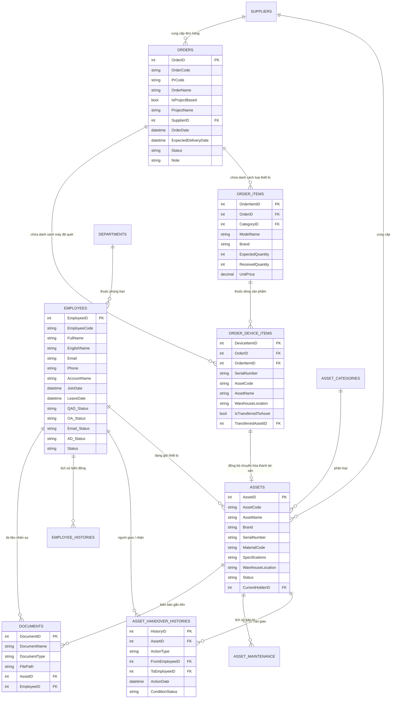

# 🏢 QLKHO - HỆ THỐNG QUẢN LÝ KHO TÀI SẢN IT & BÀN GIAO THIẾT BỊ DOANH NGHIỆP

> **Hệ thống Quản lý Thiết bị Doanh nghiệp (Enterprise IT Asset & Employee Equipment Management System)**  
> Giải pháp toàn diện giúp bộ phận IT & Nhân sự (HR) theo dõi vòng đời thiết bị máy tính, quản lý quy trình nhập mua đơn hàng (PO/PR), đối soát quét mã vạch Serial, đồng bộ tự động vào kho tài sản, quản lý 4 tài khoản hệ thống (QAD, OA, Email, AD), cấp phát trọn gói, thu hồi, điều chuyển, in tem mã QR dán máy, quản lý hồ sơ biên bản bàn giao PDF và phân tích sự cố bảo trì theo thời gian thực.

---

## 📑 MỤC LỤC

1. [Tổng Quan Dự Án](#-tổng-quan-dự-án)
2. [Kiến Trúc & Công Nghệ Sử Dụng](#-kiến-trúc--công-nghệ-sử-dụng)
3. [Cấu Trúc Thư Mục Dự Án](#-cấu-trúc-thư-mục-dự-án)
4. [Các Phân Hệ & Tính Năng Trọng Tâm](#-các-phân-hệ--tính-năng-trọng-tâm)
   - [1. Quản Lý Đơn Hàng & Nhập Kho Thiết Bị (`Orders`)](#1-quản-lý-đơn-hàng--nhập-kho-thiết-bị-orders)
   - [2. Quản Lý Kho Tài Sản IT (`Assets`)](#2-quản-lý-kho-tài-sản-it-assets)
   - [3. Cấp Phát Trọn Gói ACID (`Bundle Assign`)](#3-cấp-phát-trọn-gói-acid-bundle-assign)
   - [5. Lịch Sử Biến Động Thiết Bị & Kiểm Soát Điều Chuyển](#5-lịch-sử-biến-động-thiết-bị--kiểm-soát-điều-chuyển)
   - [6. Quản Lý Nhân Sự & 4 Tài Khoản Hệ Thống (`Employees`)](#6-quản-lý-nhân-sự--4-tài-khoản-hệ-thống-employees)
   - [7. Cảnh Báo Nghỉ Việc & Chưa Có Biên Bản](#7-cảnh-báo-nghỉ-việc--chưa-có-biên-bản)
   - [8. Quản Lý Lô Phụ Kiện Tự Động Sinh Mã (Chuột / Bàn Phím)](#8-quản-lý-lô-phụ-kiện-tự-động-sinh-mã-chuột--bàn-phím)
   - [9. Lưu Trữ Hồ Sơ PDF Scan Theo Thiết Bị (`Documents`)](#9-lưu-trữ-hồ-sơ-pdf-scan-theo-thiết-bị-documents)
   - [10. In Biên Bản Bàn Giao A4 Chuẩn Doanh Nghiệp](#10-in-biên-bản-bàn-giao-a4-chuẩn-doanh-nghiệp)
   - [11. Dashboard Phân Tích & Biểu Đồ Sự Cố Theo Tháng](#11-dashboard-phân-tích--biểu-đồ-sự-cố-theo-tháng)
   - [12. Import & Export Excel / CSV UTF-8 BOM](#12-import--export-excel--csv-utf-8-bom)
5. [Mô Hình Cơ Sở Dữ Liệu (`Database Schema`)](#-mô-hình-cơ-sở-dữ-liệu-database-schema)
6. [Phân Quyền Người Dùng (`RBAC`)](#-phân-quyền-người-dùng-rbac)
7. [Hướng Dẫn Cài Đặt & Vận Hành](#-hướng-dẫn-cài-đặt--vận-hành)
8. [Triển Khai Với Docker Compose](#-triển-khai-với-docker-compose-khuyến-nghị-cho-production)
9. [Tài Khoản Mặc Định](#-tài-khoản-mặc-định)

---

## 🌟 TỔNG QUAN DỰ ÁN

Hệ thống **QLKho** được thiết kế nhằm số hóa và chuẩn hóa 100% quy trình quản trị tài sản Công nghệ thông tin trong doanh nghiệp, giải quyết triệt để các bài toán:
- **Quản lý quy trình nhập mua đơn hàng (PO/PR)**: Quản lý từng đơn đặt hàng, khai báo nhiều loại thiết bị, đối soát số lượng thực tế nhận được so với đơn đặt hàng và tự động cảnh báo thiếu hàng khi vận chuyển.
- **Quản lý vòng đời tài sản**: Từ lúc tiếp nhận từ nhà cung cấp, quét kiểm tra mã Serial/Service Tag, dán tem QR biên bản, nhập kho IT, cấp phát cho nhân sự, điều chuyển giữa các phòng ban, bảo hành/sửa chữa cho đến thu hồi và thanh lý.
- **Đồng bộ IT & HR**: Kiểm soát trạng thái 4 tài khoản nghiệp vụ của nhân sự (**QAD, OA, Email Công Ty, Active Directory**) song song với số lượng thiết bị họ đang quản lý và sử dụng.
- **Chống thất thoát tài sản**: Cảnh báo sớm nhân viên đã có lịch nghỉ việc nhưng chưa hoàn tất thủ tục bàn giao máy tính hoặc chưa khóa tài khoản; cảnh báo thiết bị đã bàn giao nhưng chưa nạp file scan PDF biên bản có chữ ký xác nhận.
- **Tiêu chuẩn hóa in ấn & số hóa tài liệu**: Xuất biên bản bàn giao thiết bị ra file PDF/In trực tiếp chuẩn khổ giấy A4, đồng thời tạo mã QR Code dán tem lên thân máy để tra cứu tức thì thông tin biên bản bàn giao.

---

## 🛠️ KIẾN TRÚC & CÔNG NGHỆ SỬ DỤNG



### 1. Backend API (`QLKho.Api`)
- **Framework**: `.NET 10.0 (C#)`
- **ORM**: `Entity Framework Core 10.0 (Code First với PostgreSQL / Npgsql Provider)`
- **Kiến trúc**: **Layered Architecture / Service-Repository Pattern**
  - `Controllers`: Tiếp nhận Request HTTP, Validate ModelState, phân quyền Endpoint, gọi Services.
  - `Services (Interfaces & Implementations)`: Xử lý toàn bộ Business Logic nghiệp vụ (`OrderService`, `AssetService`, `EmployeeService`, `HandoverQrService`, `DashboardService`, `DocumentService`, `CommonServices`).
  - `Models / DTOs`: Định dạng dữ liệu truyền nhận (Data Transfer Objects) an toàn và tối ưu băng thông.
  - `Models / Entities`: Mô hình thực thể cơ sở dữ liệu với Data Annotations và Fluent API.
  - `Data / AppDbContext`: Cấu hình quan hệ bảng, Cascade Delete, Check Constraints, tự động khởi tạo Schema (`EnsureCreated`).
- **Ghi log & Xử lý lỗi**: Tích hợp Global Exception Handling, EF Execution Strategy chống ngắt kết nối.

### 2. Frontend Web Client (`QLkho.Web`)
- **Framework**: `Vue 3 (Composition API với <script setup>)`
- **Build Tool**: `Vite 8.2`
- **Routing**: `Vue Router 4`
- **HTTP Client**: `Axios` (Tích hợp Request/Response Interceptors tự động gán Token, xử lý FormData upload file và bắt lỗi toàn cục)
- **Thiết kế UI/UX**: `Vanilla CSS Modern Design System` (CSS Variables, Glassmorphism, Dark/Light palettes, responsive đa màn hình, hiệu ứng micro-animations mượt mà, dropdown action menu tiện ích)
- **Thư viện phụ trợ**: `jspdf` & `html2canvas` (In/xuất PDF chuẩn A4), `xlsx` (Đọc/ghi file Excel/CSV UTF-8 BOM), `qrcode` (Tạo và in mã QR tem dán thiết bị).

### 3. Cơ Sở Dữ Liệu
- **Hệ quản trị**: `PostgreSQL 16+` (Triển khai tối ưu trên Docker Alpine nhẹ và ổn định)
- **Tên DB**: `qlkho_db`
- **Hỗ trợ**: Unicode Tiếng Việt chuẩn xác (`VARCHAR`, `TEXT`), Khóa ngoại ràng buộc toàn vẹn dữ liệu, chỉ mục Index tốc độ cao trên các trường tìm kiếm (`SerialNumber`, `AssetCode`, `OrderCode`, `PrCode`, `EmployeeCode`).

---

## 📂 CẤU TRÚC THƯ MỤC DỰ ÁN

```text
d:/Project/QLkho/
├── QLKho.Api/                        # Source Code Backend ASP.NET Core 10
│   ├── Controllers/                  # API Controllers:
│   │   ├── OrdersController.cs       # API Quản lý Đơn hàng & Quét Serial thiết bị
│   │   ├── AssetsController.cs       # API Quản lý Kho tài sản & Cấp phát
│   │   ├── EmployeesController.cs    # API Quản lý Nhân sự & 4 Tài khoản
│   │   ├── HandoverQrController.cs   # API Tạo & In tem QR biên bản bàn giao
│   │   ├── DocumentsController.cs    # API Lưu trữ & Tra cứu file PDF scan
│   │   ├── DashboardController.cs    # API Thống kê & Biểu đồ KPI
│   │   └── CategoriesController.cs   # API Danh mục loại tài sản & Nhà cung cấp
│   ├── Data/                         # AppDbContext & Cấu hình Entity Framework
│   ├── Models/
│   │   ├── Entities/                 # Database Entities (Order, OrderItem, Asset, Employee...)
│   │   └── DTOs/                     # DTOs (OrderDtos, AssetDtos, EmployeeDtos...)
│   ├── Services/
│   │   ├── Interfaces/               # Giao diện dịch vụ (IOrderService, IAssetService...)
│   │   └── Implementations/          # Triển khai dịch vụ (OrderService, AssetService...)
│   ├── Utils/                        # Các hàm tiện ích bổ trợ
│   ├── wwwroot/                      # Thư mục lưu trữ tĩnh (File PDF bàn giao đã scan, file QR)
│   ├── appsettings.json              # Chuỗi kết nối Database & cấu hình hệ thống
│   ├── Dockerfile                    # Docker build multi-stage cho Backend
│   └── Program.cs                    # Điểm khởi động ứng dụng & cấu hình DI Containers
│
├── QLkho.Web/                        # Source Code Frontend Vue 3 + Vite
│   ├── public/                       # Assets tĩnh & Logo doanh nghiệp
│   ├── src/
│   │   ├── api/                      # Client Axios & cấu hình API endpoints (client.js)
│   │   ├── components/               # Components dùng chung:
│   │   │   ├── layout/               # Header, Sidebar, Navigation
│   │   │   ├── common/               # Modal, Toast, StatusBadge, Pagination
│   │   │   └── dashboard/            # HighlightWidget, ChartWidgets
│   │   ├── views/                    # Các màn hình phân hệ chính:
│   │   │   ├── OrdersView.vue        # 📦 QUẢN LÝ ĐƠN HÀNG, ĐỐI SOÁT & NHẬP KHO
│   │   │   ├── AssetsView.vue        # 💻 QUẢN LÝ KHO TÀI SẢN & CẤP PHÁT TRỌN GÓI
│   │   │   ├── EmployeesView.vue     # 👤 QUẢN LÝ NHÂN SỰ & 4 TÀI KHOẢN HỆ THỐNG
│   │   │   ├── DocumentsView.vue     # 📑 LƯU TRỮ HỒ SƠ BIÊN BẢN PDF SCAN
│   │   │   ├── CategoriesSuppliersView.vue # 🏢 DANH MỤC THIẾT BỊ & NHÀ CUNG CẤP
│   │   │   ├── DashboardView.vue     # 📊 TỔNG QUAN KPI & BIỂU ĐỒ SỰ CỐ
│   │   │   └── UsersView.vue         # 🔑 QUẢN TRỊ TÀI KHOẢN ĐĂNG NHẬP & PHÂN QUYỀN
│   │   ├── utils/                    # Xử lý Excel, CSV, PDF, QR Code, ngày tháng
│   │   ├── App.vue                   # Root Component
│   │   └── main.js                   # Điểm khởi động Vue App
│   ├── nginx.conf                    # Cấu hình Nginx Reverse Proxy cho Frontend
│   ├── Dockerfile                    # Docker build Vue 3 & Nginx
│   └── package.json                  # Dependencies & scripts npm
│
├── database/                         # Kịch bản cơ sở dữ liệu
│   ├── mssql_schema_and_seed.sql     # Script dự phòng tạo schema MS SQL
│   └── README_DB.md                  # Hướng dẫn cấu hình kết nối DB
│
├── docker-compose.yml                # Cấu hình khởi chạy toàn bộ hệ thống bằng Docker
└── README.md                         # Tài liệu hướng dẫn toàn diện dự án
```

---

## 🎯 CÁC PHÂN HỆ & TÍNH NĂNG TRỌNG TÂM

### 1. Quản Lý Đơn Hàng & Nhập Kho Thiết Bị (`Orders`)
Phân hệ quản lý chuỗi cung ứng đầu vào, đối soát thực tế và chuyển giao sang kho tài sản:
- **Khởi tạo Đơn Hàng (Bước 1)**:
  - Cho phép nhập hoặc bỏ trống **Mã PR (PR Code)** (hệ thống tự động đồng bộ tên đơn theo mã đơn nếu không có PR).
  - Tự động sinh **Mã đơn hàng PO** chuẩn định dạng ngày tháng (Vd: `PO-20261008-001`).
  - Gán Nhà cung cấp, Dự án cụ thể (nếu là đơn cấp riêng cho Dự án), Ghi chú, Ngày nhận dự kiến.
  - Khai báo danh sách nhiều loại thiết bị cần mua kèm số lượng dự kiến từng loại.
- **Bộ Nút CRUD Độc Đáo: Gom 4 Nút Vào 1 Nút Duy Nhất**:
  - Tại mỗi dòng đơn hàng trên bảng, thay vì hiển thị nhiều nút bấm rời rạc làm vỡ layout, hệ thống tích hợp nút bấm **`⚙️ Thao tác ▾`**.
  - Nhấp vào nút sẽ mở Menu Dropdown hiện đại, mượt mà với trọn vẹn **4 thao tác CRUD**:
    1. **🔍 Xem Chi Tiết & Nhập Máy (Read)**: Mở bảng kiểm đếm đối soát, quét mã vạch và xem tiến độ.
    2. **✏️ Chỉnh Sửa Đơn Hàng (Update)**: Cập nhật thông tin đơn hàng đã tạo (Mã PR, Dự án, Nhà cung cấp, Trạng thái, Ngày giao dự kiến, Ghi chú).
    3. **➕ Thêm Loại Thiết Bị (Create Order Item)**: Mở popup bổ sung thêm dòng thiết bị mới cần mua vào chính đơn hàng đó mà không cần tạo lại đơn mới.
    4. **🗑️ Xóa Đơn Hàng (Delete)**: Gỡ bỏ đơn hàng an toàn với hộp thoại xác nhận.
- **Đối Soát Thực Tế & Quét Mã Vạch Serial (Bước 2)**:
  - **Quét từng máy (Single Scan)**: Hỗ trợ đầu đọc mã vạch (Barcode Scanner) tự động bắt tiêu điểm (auto-focus), phát âm thanh tiếng *beep* xác nhận khi quét thành công hoặc âm cảnh báo lỗi nếu trùng lặp.
  - **Dán hàng loạt (Bulk Paste)**: Hỗ trợ copy/paste danh sách hàng chục mã Serial từ file Excel của nhà cung cấp vào ô nhập liệu; hệ thống tự động bóc tách từng dòng.
  - **Chống trùng lặp đa lớp**: Chặn thêm trùng mã Serial ngay trên form, chặn trùng với các máy đã có trong cùng đơn, và chặn trùng với máy đã tồn tại trong toàn bộ kho dữ liệu.
  - **Cảnh báo thiếu hàng (`Shortage Warning`)**: Tự động so khớp số lượng nhận thực tế với số lượng dự kiến theo từng loại thiết bị; gắn thẻ cảnh báo màu đỏ nổi bật `⚠️ Thiếu X máy (Vận chuyển thiếu)` trên bảng danh sách và thẻ KPI.
- **Đồng Bộ Tự Động Sang Kho Quản Lý Tài Sản (`Sync to Assets`) (Bước 3)**:
  - Chỉ bằng một cú nhấp chuột **"🚀 Đồng Bộ Vào Quản Lý Tài Sản"**, toàn bộ thiết bị đã quét nhận sẽ được tự động sinh Mã tài sản (`AssetCode`), nạp vào bảng `Assets` ở trạng thái sẵn sàng trong kho IT và ghi nhận thông tin nguồn gốc theo đơn hàng.

---

### 2. Quản Lý Kho Tài Sản IT (`Assets`)
- **Hiển thị thông minh**: Tự động đưa các nhóm phụ kiện có số lượng (Chuột, Bàn phím lô) lên đầu bảng; các dòng máy tính cá nhân (Laptop, Desktop PC, Màn hình) xếp theo thứ tự ưu tiên: `Sẵn sàng` $\rightarrow$ `Đang cấp phát` $\rightarrow$ `Đang bảo trì` $\rightarrow$ `Bị hỏng`.
- **Cố định khung bảng (`table-layout: fixed`)**: Khi click mở rộng chi tiết các con chuột trong lô, bảng giữ nguyên kích thước từng pixel, không bị nhảy hay xô lệch cột.
- **Bộ lọc đa năng**: Tìm kiếm tức thì theo Host Name, Model, Serial/Service Tag, Mã VT, Người đang giữ, Hãng sản xuất, Phòng ban, Trạng thái.
- **Chi tiết thiết bị & Timeline**: Xem toàn bộ thông số kỹ thuật (CPU, RAM, Ổ cứng, Màn hình, Sạc đi kèm) và dòng thời gian lịch sử cấp phát từ ngày mua đến hiện tại.

---

### 3. Cấp Phát Trọn Gói ACID (`Bundle Assign`)
- Nghiệp vụ cấp máy chuẩn cho nhân viên mới chỉ bằng 1 thao tác duy nhất:
  - Chọn **Laptop chính** (hoặc PC).
  - Tự động gợi ý & chọn kèm **Chuột**, **Bàn phím**, **Màn hình phụ** có sẵn trong kho.
  - Backend thực thi trong **Transaction ACID** duy nhất: Cập nhật trạng thái tất cả thiết bị sang `In-Use`, gán `CurrentHolderID`, tự động sinh các bản ghi Lịch sử bàn giao (`AssetHandoverHistories`) và Lịch sử nhân sự (`EmployeeHistories`).

---

### 4. In Tem Mã QR Biên Bản Bàn Giao Dán Thiết Bị
- **Tạo mã QR động cho từng Biên Bản Bàn Giao**: Hệ thống tích hợp dịch vụ `HandoverQrService` tự động sinh mã QR Code cho biên bản bàn giao thiết bị.
- **Dán tem nhận diện lên thân máy**: Nhân viên IT có thể in tem mã QR dạng nhãn dán nhỏ để dán trực tiếp lên vỏ máy tính, thân màn hình hoặc thiết bị.
- **Quét tra cứu tức thì**: Bất kỳ lúc nào, chỉ cần dùng camera điện thoại hoặc máy quét quét tem QR trên máy, hệ thống sẽ mở ra chi tiết biên bản bàn giao gốc (người đang chịu trách nhiệm quản lý, ngày bàn giao, cấu hình và tình trạng thiết bị).

---

### 5. Lịch Sử Biến Động Thiết Bị & Kiểm Soát Điều Chuyển
- **Nhật ký biến động xuyên suốt (Audit Log)**: Mỗi thiết bị từ lúc vào kho đến khi thanh lý đều được lưu trữ toàn bộ lịch sử biến động qua bảng `AssetHandoverHistories`.
- **Điều chuyển thiết bị giữa nhân viên**:
  - Hỗ trợ chuyển giao thiết bị trực tiếp từ Nhân viên A sang Nhân viên B.
  - Tự động cập nhật chủ sở hữu mới (`CurrentHolder`), ghi nhận biên bản điều chuyển mới và cập nhật trạng thái các tài khoản nghiệp vụ tương ứng của cả hai nhân sự.

---

### 6. Quản Lý Nhân Sự & 4 Tài Khoản Hệ Thống (`Employees`)
- **Theo dõi 4 Tài khoản cốt lõi**:
  - 🖥️ **QAD**: Tài khoản phần mềm ERP/Kế toán/Sản xuất.
  - 📋 **OA**: Tài khoản phần mềm quản trị văn phòng/trình ký.
  - ✉️ **Email Cty**: Hộp thư điện tử doanh nghiệp.
  - 🔑 **Active Directory (AD)**: Tài khoản đăng nhập máy tính miền domain & mạng nội bộ.
- **Account đăng nhập (`AccountName`)**: Ô nhập tài khoản AD của nhân sự (mặc định `AP\`, vd `AP\username`) trong form thêm/sửa nhân sự. Khi in biên bản bàn giao, ô Account tự điền giá trị này, không cần nhập tay.
- **Trạng thái tài khoản**: `Available` (Đang hoạt động - Xanh), `Disable` (Đang khóa - Xám), `Deleted` (Đã xóa - Đỏ).
- **Phân loại Tab nhân sự**:
  - 💼 **Đang làm việc (`Active`)**: Danh sách nhân viên chính thức đang công tác.
  - 🚀 **Chờ đi làm (`Onboarding`)**: Nhân sự mới sắp gia nhập, đếm ngược số ngày còn lại, chuẩn bị sẵn máy tính và email.
  - 📁 **Đã nghỉ việc (`Resigned`)**: Nhân viên đã thôi việc, kiểm tra việc hoàn tất bàn giao máy và vô hiệu hóa tài khoản.

---

### 7. Cảnh Báo Nghỉ Việc & Chưa Có Biên Bản
- ⚠️ **Cảnh Báo Nghỉ Việc**: Tự động lọc ra những nhân sự đã có ngày nghỉ việc (`LeaveDate`) hoặc trạng thái `Resigned` nhưng **vẫn còn đang giữ thiết bị** hoặc **chưa bị vô hiệu hóa 4 tài khoản hệ thống**.
- 📑 **Cảnh Báo Chưa Có Biên Bản**: Liệt kê các thiết bị đã bàn giao cho nhân viên sử dụng nhưng chưa được tải lên file scan PDF biên bản bàn giao có chữ ký để IT bổ sung kịp thời.

---

### 8. Quản Lý Lô Phụ Kiện Tự Động Sinh Mã (Chuột / Bàn Phím)
- Khi nhập số lượng lớn chuột / bàn phím theo lô (Vd: nhập 20 con chuột Logitech M10):
  - Hệ thống tự động phân tích mã cao nhất hiện có trong DB (Vd: `MOU-LOGI-05`).
  - Tự động sinh dải mã liên tục tiếp theo (`MOU-LOGI-06` $\rightarrow$ `MOU-LOGI-25`).
  - Trên giao diện được gom thành 1 dòng duy nhất: `Chuột Logitech (📦 20 con)` kèm thống kê nhanh số con trong kho, số con đang dùng và số con bị hỏng.

---

### 9. Lưu Trữ Hồ Sơ PDF Scan Theo Thiết Bị (`Documents`)
- Mỗi thiết bị khi bàn giao cho nhân viên sẽ có biên bản riêng biệt.
- Khi tải lên file scan PDF cho một thiết bị cụ thể:
  - Chỉ thiết bị đó nhận biên bản (`handoverDocument`).
  - Tự động lưu và đồng bộ vào phân hệ **"Lưu Trữ Hồ Sơ PDF"** (`DocumentsView`) với đầy đủ metadata: Tên biên bản, Thiết bị, Nhân viên, Phòng ban, Ngày nạp, Link xem trước / tải về.

---

### 10. In Biên Bản Bàn Giao A4 Chuẩn Doanh Nghiệp
- Tích hợp modal in biên bản trực tiếp trên trình duyệt:
  - Form in biên bản chuẩn khổ giấy A4, có logo doanh nghiệp, tiêu đề Quốc hiệu, thông tin chi tiết máy móc (Laptop, Chuột, Sạc, Tình trạng), cam kết trách nhiệm của người nhận và các ô ký tên (Người bàn giao, Người nhận, Trưởng bộ phận, IT).
  - Hỗ trợ in đơn lẻ hoặc in gộp nhiều thiết bị cùng lúc.

---

### 11. Dashboard Phân Tích & Biểu Đồ Sự Cố Theo Tháng
- **Thống kê KPI thời gian thực**: Tổng tài sản, Số lượng sẵn sàng, Đang cấp phát, Bị hỏng, Đang sửa chữa, Nhân sự đang làm việc.
- **Biểu đồ Cột Hãng Hỏng & Bảo Trì**: Truy vấn trực tiếp từ bảng Lịch sử bàn giao (`AssetHandoverHistories`) để thống kê chính xác số lượt sự cố theo từng Hãng (Dell, HP, Lenovo, LG, Logitech...) và hỗ trợ lọc động theo từng Tháng (`yyyy-MM`) hoặc toàn thời gian.
- **Biểu đồ phân bổ tài sản theo phòng ban**: Tỷ lệ phần trăm thiết bị đang được sử dụng tại các khối phòng ban.

---

### 12. Import & Export Excel / CSV UTF-8 BOM
- **Import Excel thông minh**: Nhập danh sách nhân sự, thiết bị từ file Excel (.xlsx), tự động nhận diện cột linh hoạt không phụ thuộc thứ tự cột, tự động khớp phòng ban/loại thiết bị và tạo mới nếu chưa có.
- **Export CSV chuẩn UTF-8 BOM**:
  - Xuất dữ liệu nhân sự riêng biệt: *DS Đang làm việc*, *DS Đã nghỉ việc* (có cột ngày nghỉ, tình trạng bàn giao máy), *DS Chờ đi làm*.
  - Xuất danh sách tài sản, lịch sử bàn giao không bị lỗi font tiếng Việt khi mở trực tiếp trên Microsoft Excel.

---

## 🗄️ MÔ HÌNH CƠ SỞ DỮ LIỆU (`DATABASE SCHEMA`)



---

## 👥 PHÂN QUYỀN NGƯỜI DÙNG (`RBAC`)

| Tính Năng / Nghiệp Vụ | Quản Trị Viên (`Admin`) / IT | Nhân Sự (`HR`) |
| :--- | :---: | :---: |
| **Xem Dashboard & Thống kê tài sản** | ✅ Toàn quyền | ✅ Xem |
| **Quản lý Đơn hàng & Quét nhận thiết bị nhập kho** | ✅ Toàn quyền | 🔒 Không có quyền |
| **Thêm, sửa, xóa, quản lý thiết bị trong kho** | ✅ Toàn quyền | 🔒 Không có quyền |
| **Cấp phát, Thu hồi, Điều chuyển máy tính** | ✅ Toàn quyền | 🔒 Không có quyền |
| **Báo hỏng, Đi sửa, Bảo trì thiết bị** | ✅ Toàn quyền | 🔒 Không có quyền |
| **Tạo và in tem mã QR dán thiết bị** | ✅ Toàn quyền | 🔒 Không có quyền |
| **Quản lý danh sách nhân sự (Thêm/Sửa thông tin cơ bản)** | ✅ Toàn quyền | ✅ Toàn quyền |
| **Bật/Tắt 4 tài khoản hệ thống (QAD, OA, Email, AD)** | ✅ Quyền IT/Admin | 🔒 Chỉ xem (Chế độ HR Read-only) |
| **Theo dõi nhân sự mới & Onboarding** | ✅ Xem | ✅ Quản lý chính |
| **Theo dõi Cảnh báo nghỉ việc & Thiếu biên bản** | ✅ Toàn quyền | ✅ Xem cảnh báo |
| **Import / Export Excel dữ liệu** | ✅ Toàn quyền | ✅ Toàn quyền |

---

## 🚀 HƯỚNG DẪN CÀI ĐẶT & VẬN HÀNH

### 1. Yêu Cầu Môi Trường (Khi chạy không dùng Docker)
- **Hệ điều hành**: Windows 10/11, Windows Server hoặc Ubuntu/Debian Linux.
- **.NET SDK**: Phiên bản **.NET 10.0** trở lên.
- **Node.js**: Phiên bản **Node.js 18.x** trở lên & npm.
- **Database**: **PostgreSQL 16+** (hoặc Microsoft SQL Server tuỳ cấu hình).

---

### 2. Khởi Chạy Backend API
1. Mở terminal, điều hướng đến thư mục backend:
   ```bash
   cd d:/Project/QLkho/QLKho.Api
   ```
2. Kiểm tra cấu hình chuỗi kết nối Database trong file `appsettings.json`:
   ```json
   "ConnectionStrings": {
     "DefaultConnection": "Host=localhost;Port=5433;Database=qlkho_db;Username=postgres;Password=postgres@2026;Include Error Detail=true;"
   }
   ```
3. Cấu hình API key Gemini mới trong `QLKho.Api/appsettings.Local.json` (tệp này bị Git bỏ qua, không commit key):
   ```json
   {
     "Gemini": {
       "ApiKey": "DÁN_GEMINI_API_KEY_MỚI_VÀO_ĐÂY"
     }
   }
   ```
   Endpoint Gemini được giới hạn 10 yêu cầu/phút theo địa chỉ IP.
4. Khôi phục packages & chạy ứng dụng:
   ```bash
   dotnet restore
   dotnet run
   ```
5. Backend API sẽ khởi chạy tại địa chỉ: `http://localhost:5000` (Swagger UI: `http://localhost:5000/swagger`).

---

### 3. Khởi Chạy Frontend Client
1. Mở một cửa sổ terminal mới, điều hướng đến thư mục frontend:
   ```bash
   cd d:/Project/QLkho/QLkho.Web
   ```
2. Cài đặt các thư viện phụ thuộc:
   ```bash
   npm install
   ```
3. Khởi chạy Development Server:
   ```bash
   npm run dev
   ```
4. Truy cập hệ thống trên trình duyệt tại: `http://localhost:5173`.

---

## 🐳 TRIỂN KHAI VỚI DOCKER COMPOSE (Khuyến Nghị Cho Production)

Dự án đã được đóng gói toàn diện với Docker Compose, bao gồm **PostgreSQL 16 Alpine**, **.NET 10 Web API** và **Vue 3 Web App (Nginx Reverse Proxy)**.

### 1. Khởi chạy toàn bộ hệ thống bằng 1 lệnh:
```bash
# Đứng tại thư mục gốc dự án d:/Project/QLkho/
docker compose up -d --build
```

### 2. Kiểm tra trạng thái các container:
```bash
docker compose ps
```

### 3. Địa chỉ truy cập sau khi deploy:
- **Ứng Dụng Web (Frontend & Nginx)**: `http://localhost:6767`
- **Backend Web API (Trực tiếp)**: `http://localhost:5000` (Swagger: `http://localhost:5000/swagger`)
- **PostgreSQL Database**: `localhost:5433` (User: `postgres` | Password: `postgres@2026` | Database: `qlkho_db`)

### 4. Cập nhật khi có thay đổi mã nguồn:
```bash
# Cập nhật cả backend và frontend
docker compose up -d --build backend frontend
```

### 5. Dừng hệ thống:
```bash
docker compose down
```

---

## 🔐 TÀI KHOẢN MẶC ĐỊNH

Hệ thống được khởi tạo sẵn các tài khoản thử nghiệm sau:

| Tên Đăng Nhập (`Username`) | Mật Khẩu (`Password`) | Quyền Hạn (`Role`) | Ghi Chú |
| :--- | :--- | :--- | :--- |
| **`admin`** | `admin123` | **Administrator** | Toàn quyền quản trị hệ thống, kho bãi, đơn hàng & tài khoản |
| **`it_support`** | `admin123` | **IT Support** | Quản lý đơn hàng, thiết bị, cấp phát, bảo trì, in ấn tem QR & biên bản |
| **`hr`** | `admin123` | **HR** | Quản lý nhân sự, theo dõi onboarding, xem cảnh báo |

---

## 📄 BẢN QUYỀN & TÁC GIẢ

- **Dự án**: Phần mềm Quản Lý Kho Tài Sản IT & Bàn Giao Thiết Bị Doanh Nghiệp (QLKho)
- **Đơn vị phát triển**: Nguyễn Công Khánh
- **Phiên bản**: `v2.2.0 Enterprise Edition` 